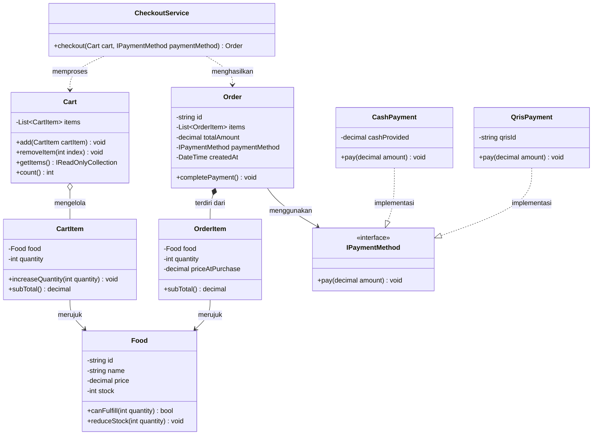
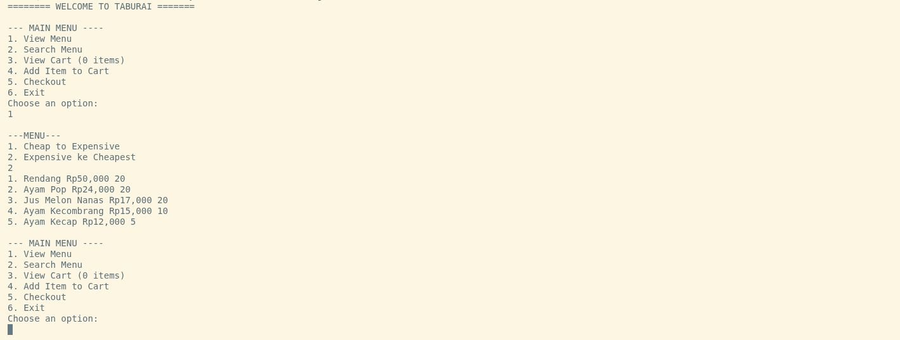
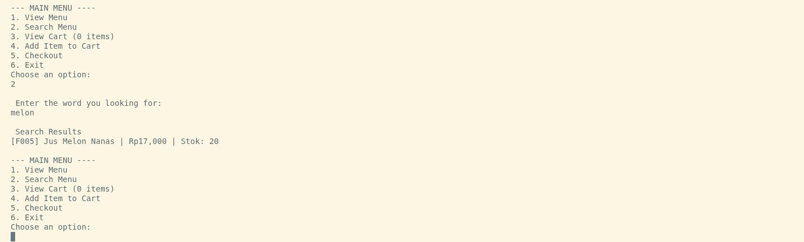
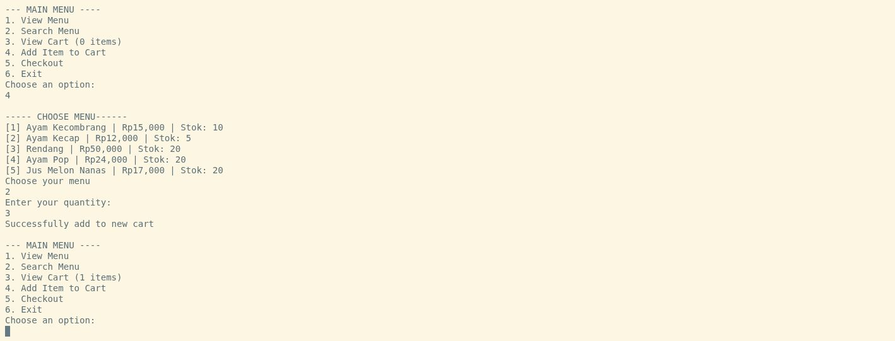
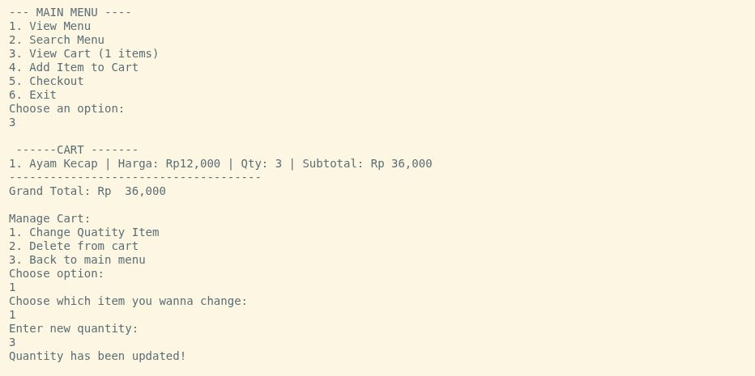
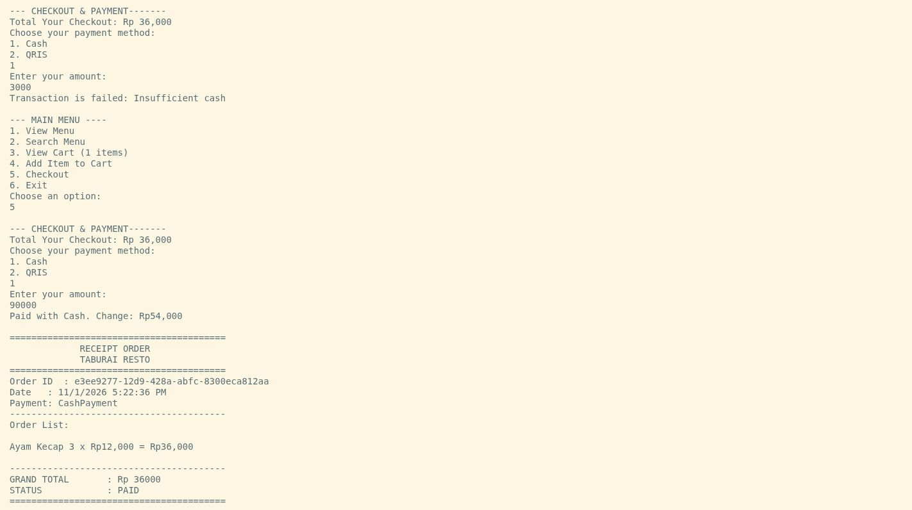

# Taburai Resto - Console Ordering & Payment System

Sistem pemesanan makanan dan pembayaran berbasis antarmuka konsol (CLI) untuk Restoran Taburai. Proyek ini dibangun dengan menerapkan prinsip-prinsip Pemrograman Berorientasi Objek (**Object-Oriented Programming / OOP**) yang solid, bersih, dan mudah dikembangkan.

Aplikasi ini tersedia dalam dua implementasi bahasa:
- **Java** (`java/`)
- **C# / .NET** (`dotnet/`)

---

## Daftar Isi
1. [Fitur Utama](#fitur-utama)
2. [Struktur Class](#struktur-class)
   - [Diagram Class](#diagram-class)
   - [Penjelasan Masing-Masing Class](#penjelasan-masing-masing-class)
3. [Penerapan Konsep OOP](#penerapan-konsep-oop)
4. [Cara Menjalankan Aplikasi](#cara-menjalankan-aplikasi)
   - [Menjalankan Versi .NET (C#)](#menjalankan-versi-net-c)
   - [Menjalankan Versi Java](#menjalankan-versi-java)
5. [Screenshot Hasil Program](#screenshot-hasil-program)

---

## Fitur Utama

- **View Menu**: Menampilkan daftar menu makanan beserta harga dan sisa stok, dilengkapi opsi pengurutan (termurah ke termahal atau termahal ke termurah).
- **Search Menu**: Mencari menu makanan berdasarkan kata kunci nama (*case-insensitive*).
- **Add Item to Cart**: Menambahkan makanan ke keranjang belanja dengan validasi stok secara otomatis.
- **Manage Cart**: Melihat isi keranjang, mengubah jumlah kuantitas pesanan, serta menghapus item dari keranjang.
- **Checkout & Multi-Payment**: Memvalidasi ketersediaan stok, mengubah keranjang menjadi pesanan (*Order*), memotong stok menu, serta mendukung metode pembayaran fleksibel:
  - **Cash (Tunai)**: Validasi kecukupan uang tunai dan perhitungan uang kembalian.
  - **QRIS (Digital)**: Simulasi pembayaran digital berbasis QRIS ID.
- **Print Receipt**: Menampilkan struk pesanan resmi berisi ID transaksi, tanggal, rincian item, dan total pembayaran.

---

## Struktur Class

### Diagram Class



---

### Penjelasan Masing-Masing Class

| Paket / Namespace | Nama Class / Interface | Tanggung Jawab & Deskripsi |
| :--- | :--- | :--- |
| **Model** | `Food` | Entitas data makanan yang menyimpan informasi `Id`, `Name`, `Price`, dan `Stock`. Memiliki metode domain untuk memeriksa ketersediaan stok (`canFulfill`) dan mengurangi stok (`reduceStock`) dengan validasi batas. |
| **Model** | `CartItem` | Merepresentasikan item sementara di dalam keranjang belanja yang menghubungkan objek `Food` dengan `Quantity` yang ingin dipesan, serta menghitung subtotal sementara. |
| **Model** | `Cart` | Penampung keranjang belanja. Mengelola kumpulan `CartItem`, menangani penggabungan kuantitas jika item yang sama ditambahkan berulang, validasi stok saat penambahan, dan penghapusan item. |
| **Model** | `OrderItem` | Snapshot pesanan item yang sudah dikonfirmasi. Menyimpan `PriceAtPurchase` (harga saat pembelian) untuk menjaga integritas data riwayat transaksi jika harga di katalog makanan berubah kemudian hari. |
| **Model** | `Order` | Entitas transaksi yang telah difiksasi dari keranjang belanja. Berisi `Id` transaksi unik (UUID/Guid), waktu transaksi, daftar `OrderItem`, `TotalAmount`, serta referensi metode pembayaran. |
| **Payment** | `PaymentMethod` / `IPaymentMethod` | Interface / abstraksi kontrak pembayaran yang mewajibkan implementasi metode `pay(amount)` / `Pay(amount)`. |
| **Payment / Model** | `CashPayment` | Implementasi metode pembayaran tunai. Memvalidasi apakah uang yang diserahkan (`cashProvided`) cukup dan menghitung nominal uang kembalian. |
| **Payment / Model** | `QrisPayment` | Implementasi metode pembayaran non-tunai (QRIS) menggunakan identifier QRIS. |
| **Service** | `CheckoutService` | Lapisan logika bisnis (*service layer*) untuk transaksi: memvalidasi keranjang belanja, mengecek ulang stok sebelum transaksi, membuat `Order`, mengeksekusi pembayaran, dan memotong stok makanan. |
| **Entry Point** | `App` / `Program` | Pengontrol antarmuka berbasis konsol (CLI) yang mengelola alur program, menerima input pengguna, menampilkan menu, dan mencetak struk belanja. |

---

## Penerapan Konsep OOP

Aplikasi ini menerapkan 4 pilar utama Pemrograman Berorientasi Objek (*Object-Oriented Programming*):

### 1. Encapsulation (Enkapsulasi)
- **Data Hiding**: Semua field kritis pada model (`Food`, `CartItem`, `Order`, `CashPayment`) dideklarasikan `private` atau menggunakan *property* dengan *private setter* (`private set` / getter saja).
- **Validasi Internal**: Setiap perubahan nilai atau inisialisasi divalidasi langsung di dalam class tersebut (misalnya nama tidak boleh kosong, harga dan kuantitas tidak boleh kurang dari nol, stok tidak boleh negatif).
- **Melindungi State**: Data keranjang belanja pada class `Cart` dikembalikan dalam bentuk *read-only* (`IReadOnlyCollection` pada C# atau `List.copyOf` pada Java) sehingga pihak luar tidak dapat memanipulasi koleksi secara sepihak tanpa melalui method `Add` atau `RemoveItem`.

### 2. Abstraction (Abstraksi)
- Detail mekanisme pembayaran diabstraksikan melalui interface `IPaymentMethod` (C#) / `PaymentMethod` (Java).
- Class `Order` dan `CheckoutService` tidak perlu mengetahui detail teknis bagaimana uang tunai dihitung atau bagaimana gateway QRIS memproses transaksi. Keduanya hanya perlu mengetahui bahwa objek pembayaran memiliki kontrak method `Pay(amount)`.
- Pemisahan tanggung jawab yang jelas (*Separation of Concerns*) antara lapisan data (*Models*), lapisan bisnis (*Services*), dan lapisan antarmuka (*Console UI / Program*).

### 3. Inheritance & Interface Realization
- Class `CashPayment` dan `QrisPayment` mengimplementasikan (realize) kontrak interface `IPaymentMethod` / `PaymentMethod`.
- Memungkinkan penambahan metode pembayaran baru di masa depan (seperti kartu debit, transfer bank, atau e-wallet) cukup dengan membuat class baru yang mengimplementasikan interface pembayaran tanpa perlu mengubah kode yang ada pada `Order` atau `CheckoutService` (*Open/Closed Principle*).

### 4. Polymorphism (Polimorfisme)
- **Dynamic Dispatch / Runtime Polymorphism**: Pada saat checkout, class `Order` memanggil:
  ```csharp
  PaymentMethod.Pay(TotalAmount);
  ```
- Objek `PaymentMethod` dieksekusi secara polimorfis sesuai dengan instance yang dipilih pengguna saat runtime (`CashPayment` atau `QrisPayment`). Tidak dibutuhkan percabangan manual (`if-else` / `switch`) di dalam class `Order` untuk menentukan cara kerja pembayaran.

---

## Cara Menjalankan Aplikasi

Pastikan Anda berada di direktori utama repositori (`alvin-taburai/`).

### Menjalankan Versi .NET (C#)

**Prasyarat**: [.NET SDK](https://dotnet.microsoft.com/download) (versi 8.0, 9.0, atau 10.0).

1. Menjalankan langsung melalui .NET CLI:
   ```bash
   dotnet run --project dotnet/src/Homework.Console
   ```
2. Atau masuk ke dalam folder proyek:
   ```bash
   cd dotnet/src/Homework.Console
   dotnet run
   ```

---

### Menjalankan Versi Java

**Prasyarat**: [Java Development Kit (JDK)](https://adoptium.net/) versi 21 atau lebih baru.

- **Opsi 1: Menggunakan Maven**
  ```bash
  cd java
  mvn clean compile
  mvn exec:java -Dexec.mainClass="alvin.taburai.App"
  ```

- **Opsi 2: Menggunakan Compiler `javac` & `java` langsung**
  ```bash
  # Kompilasi seluruh file java ke folder classes
  javac -d java/target/classes $(find java/src/main/java -name "*.java")

  # Jalankan aplikasi
  java -cp java/target/classes alvin.taburai.App
  ```

---

## Screenshot Hasil Program

Berikut adalah dokumentasi tangkapan layar saat program dijalankan:

### 1. Menampilkan Menu Makanan (View Menu & Sorting)
Fitur untuk melihat katalog menu makanan dengan pilihan pengurutan berdasarkan harga (termurah ke termahal atau sebaliknya):



---

### 2. Pencarian Menu Makanan (Search Menu)
Fitur pencarian makanan berdasarkan kata kunci secara fleksibel:



---

### 3. Menambahkan Item ke Keranjang (Add to Cart)
Memilih menu makanan dan memasukkan jumlah porsi yang diinginkan, dengan pengecekan batas stok secara otomatis:



---

### 4. Mengelola Keranjang Belanja (View & Manage Cart)
Melihat daftar pesanan sementara, mengubah kuantitas porsi, atau membatalkan/menghapus item dari keranjang:



---

### 5. Proses Checkout & Cetak Struk (Checkout & Payment)
Proses pemilihan metode pembayaran (Cash / QRIS), verifikasi uang tunai & perhitungan kembalian, pemotongan stok otomatis, serta pencetakan struk pembayaran (*Receipt*):



